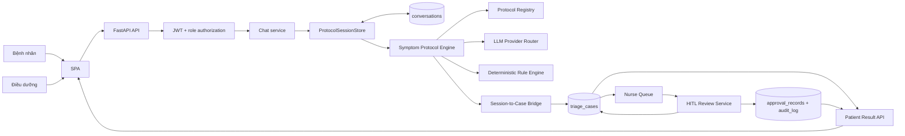
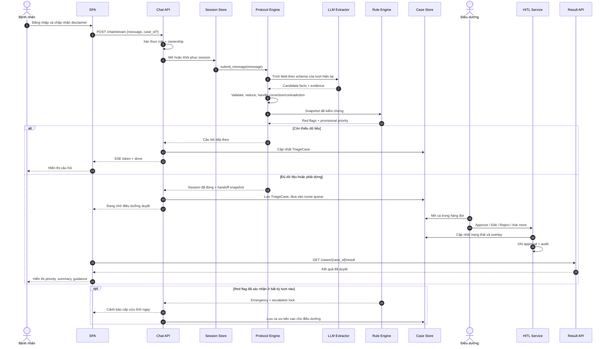
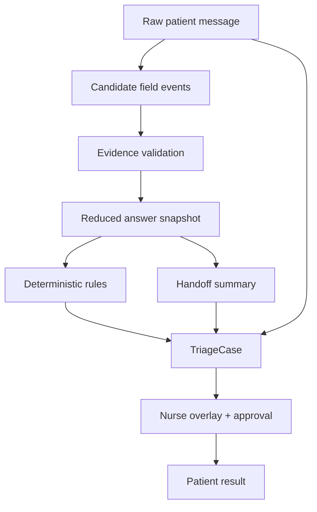
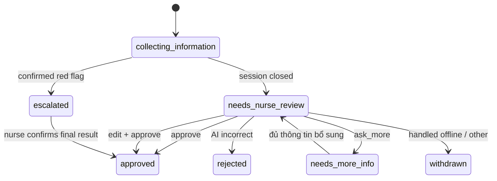

# Kiến trúc hệ thống VMedTriage

> Cập nhật: 2026-08-26
> Phạm vi: một luồng sản phẩm end-to-end từ lời khai của bệnh nhân đến kết quả đã được điều dưỡng duyệt.

## 1. Mục tiêu kiến trúc

VMedTriage là hệ thống hỗ trợ khai thác triệu chứng và đề xuất mức ưu tiên khám ban đầu. Bệnh nhân kể
triệu chứng bằng ngôn ngữ tự do; hệ thống thu thập dữ kiện theo protocol, kiểm tra dấu hiệu nguy hiểm,
tạo phiếu bàn giao có cấu trúc và chuyển ca cho điều dưỡng. Điều dưỡng là người đưa ra quyết định cuối
cùng trước khi kết quả chi tiết được gửi lại cho bệnh nhân.

Kiến trúc chỉ có một đường xử lý nghiệp vụ:

```text
Bệnh nhân -> Hội thoại triệu chứng -> Hồ sơ ca -> Hàng đợi điều dưỡng
           -> Điều dưỡng duyệt/chỉnh sửa -> Kết quả cho bệnh nhân
```

Các entrypoint phục vụ thử nghiệm, công cụ nội bộ và pipeline cũ không thuộc tài liệu này. Chúng không
được dùng làm nguồn thiết kế, nguồn dữ liệu hay đường tắt cho luồng sản phẩm.

### 1.1 Các bất biến an toàn

1. LLM được phép trích xuất và diễn đạt, nhưng không phải nguồn quyết định mức khẩn cấp.
2. Rule engine thuần quyết định mức ưu tiên tạm thời từ dữ liệu có cấu trúc.
3. Dữ kiện chỉ được ghi khi có bằng chứng trong lời người bệnh hoặc câu trả lời xác nhận tương ứng.
4. Không được nâng cấp `buồn nôn` thành `nôn`, `nôn` thành `nôn nhiều`, hoặc suy diễn mức độ/tần suất
   không được người bệnh nói rõ.
5. Im lặng không đồng nghĩa với phủ định; chưa hỏi không được ghi thành `không có`.
6. Red flag đã xác nhận phải tạo cảnh báo tĩnh ngay trong lượt và không chờ hoàn tất checklist.
7. Hệ thống có thể tự nâng mức ưu tiên vì an toàn, nhưng không tự hạ mức đã escalated.
8. Kết quả xử trí chi tiết chỉ được công bố sau khi điều dưỡng duyệt.
9. Mọi thay đổi của điều dưỡng phải giữ lại giá trị hệ thống sinh ban đầu và có audit trail.

## 2. Framework và công nghệ

| Tầng | Công nghệ | Trách nhiệm |
|---|---|---|
| Giao diện | HTML, CSS, JavaScript ES modules | Giao diện bệnh nhân và điều dưỡng, gọi REST/SSE |
| Web/API | FastAPI, Uvicorn | Routing, validation, streaming, lifecycle |
| Hợp đồng dữ liệu | Pydantic v2 | Request/response, case, summary, review schemas |
| Xác thực | JWT, `pwdlib[argon2]` | Đăng nhập, Bearer token, phân quyền patient/nurse |
| Hội thoại | `symptom_protocol` | Session, stage machine, checklist, evidence ledger |
| Suy luận có kiểm soát | Rule engine thuần | Red flag và mức ưu tiên tạm thời |
| AI hỗ trợ | Provider router, OpenAI/DeepSeek/Gemini/Anthropic/OpenRouter | Trích xuất field, viết câu hỏi/tóm tắt; có fallback |
| Lưu trữ | SQLAlchemy 2 | Postgres ở production; SQLite ở development/test |
| Kiểm duyệt | HITL review service | Approve, edit, reject, ask-more; ghi approval/audit |
| Quan sát | Structured logging, Braintrust tùy chọn | Trace theo lượt, provider/model, latency, lỗi |
| Kiểm thử | Pytest, pytest-asyncio, HTTPX, Ruff | Unit, integration, API và static analysis |

Runtime chính là một tiến trình FastAPI. SPA được phục vụ tại `/`; REST API có prefix `/api/v1`.
Hệ thống dùng SSE cho phản hồi hội thoại theo dòng, không phụ thuộc WebSocket. Tác vụ safety-gate có
thể chạy nền trong cùng tiến trình; hiện không có message broker hay worker queue độc lập.

## 3. Kiến trúc tổng thể



### 3.1 Ranh giới trách nhiệm

| Thành phần | Được làm | Không được làm |
|---|---|---|
| SPA | Thu input, hiển thị trạng thái/cảnh báo/kết quả | Tự suy luận hoặc tự sửa mức ưu tiên |
| API | Xác thực, ownership, điều phối service, lọc response theo role | Nhúng luật triệu chứng trong route |
| Intake agent | Trích field có evidence, tạo câu hỏi tự nhiên | Bịa field, quyết định triage, thay rule |
| Protocol content | Định nghĩa field, cluster, stage và rule của nhóm triệu chứng | Chứa logic persistence/API |
| Session engine | Chạy cơ chế chung cho mọi protocol | Hard-code từ vựng riêng của một triệu chứng |
| Rule engine | Tính red flag và priority từ snapshot đã validate | Dựa vào văn phong do LLM tạo để quyết định |
| Bridge | Chuyển `Session` thành `TriageCase` một cách thuần | Gọi LLM hoặc tự ghi database |
| HITL service | Áp quyết định điều dưỡng và ghi audit | Xóa dấu vết giá trị hệ thống ban đầu |
| Result API | Trả kết quả đúng ownership và approval state | Lộ guidance chi tiết khi chưa duyệt |

## 4. Luồng end-to-end chuẩn



### 4.1 Mở hoặc tiếp tục ca

`ChatRequest` gồm `message` và `case_id` tùy chọn. Nếu chưa có `case_id`, API tạo session mới. Nếu có,
API kiểm tra bệnh nhân hiện tại có sở hữu ca hay không rồi khôi phục session. Một hội thoại tương ứng
đúng một ca:

```text
case_id = session_id = conversation_id
```

Khóa định danh bền của hội thoại là `(user_id, conversation_id)`. Session đang dở được ghi sau mỗi
lượt nên có thể khôi phục sau khi tiến trình restart.

### 4.2 Xử lý một lượt hội thoại

Mỗi lượt đi qua cùng một chuỗi xử lý:

1. Nhận nguyên văn lời người bệnh và giữ trong raw conversation.
2. Chọn schema đúng với opening, probe hoặc cluster đang được hỏi.
3. LLM trả candidate fields kèm evidence; lỗi provider đi qua provider fallback.
4. Validator loại giá trị ngoài schema, thiếu evidence hoặc sai kiểu.
5. Reducer áp candidate vào snapshot, xử lý phủ định, đính chính và mâu thuẫn.
6. Safety layer kiểm tra red flag trước mọi tối ưu trải nghiệm.
7. Rule engine tính mức ưu tiên tạm thời từ snapshot.
8. Stage machine chọn câu hỏi kế tiếp hoặc đóng phiên.
9. Bridge dựng `TriageCase`; route lưu case và trả response an toàn theo role.

`POST /chat/stream` phát các event `status`, `token`, `done` và `error`. Event `done` chứa cùng hợp
đồng `ChatResponse` với `POST /chat`; vì vậy hai endpoint là hai cách truyền tải của cùng một luồng,
không phải hai pipeline.

### 4.3 Đóng phiên và chuyển điều dưỡng

Phiên đóng khi checklist hoàn tất, đạt điều kiện emergency, bệnh nhân yêu cầu dừng, bất hợp tác quá
ngưỡng, hoặc hết ngân sách hỏi theo quy tắc protocol. Khi đóng:

- snapshot có cấu trúc được chốt;
- thông tin thiếu vẫn được ghi là thiếu, không chuyển thành phủ định;
- summary và raw conversation được gắn vào phiếu bàn giao;
- case chuyển sang trạng thái cần điều dưỡng xem xét;
- `queued_at` được đặt đúng một lần để đo SLA.

Điều dưỡng đọc dữ kiện có cấu trúc, evidence, red flags, transcript và đề xuất tạm thời. Mọi field
edit là một overlay gồm giá trị sinh ban đầu, giá trị hiện tại, người sửa, thời điểm và lý do. Dữ liệu
gốc không bị ghi đè.

### 4.4 Công bố kết quả

Khi chưa có approval record, Result API chỉ trả trạng thái chờ, thời gian chờ ước tính và cờ red flag
nếu có. Nó không trả priority cuối, summary hay hướng xử trí chi tiết.

Sau khi điều dưỡng duyệt, Result API trả `final_priority`, nhãn tiếng Việt, summary và guidance tương
ứng. Endpoint luôn kiểm tra `patient_id` để bệnh nhân chỉ xem được ca của chính mình.

## 5. Framework hội thoại lâm sàng

### 5.1 Sáu lớp bất biến

Thứ tự an toàn không thay đổi giữa các nhóm triệu chứng:

| Lớp | Nội dung | Quy tắc |
|---|---|---|
| L0 | Dấu hiệu đe dọa tính mạng | Chạy trước, có thể dừng sớm và escalation lock |
| L1 | Nhóm tuổi và đối tượng | Điều chỉnh checklist/rule phù hợp |
| L2 | Bối cảnh nguy cơ | Thai kỳ, suy giảm miễn dịch, bệnh nền, phẫu thuật gần đây |
| L3 | Đặc điểm triệu chứng chính | Protocol-specific, ưu tiên câu có giá trị quyết định cao |
| L4 | Dấu hiệu cần khám sớm | Không cấp cứu tức thì nhưng ảnh hưởng priority |
| L5 | Thông tin hỗ trợ | Chỉ hỏi trong ngân sách, không được làm chậm L0-L4 |

Trong execution plan của một protocol, các lớp được triển khai thành:

```text
Emergency screen
-> Demographics
-> Symptom-specific clusters
-> Common emergency clusters
-> Common early-visit clusters
-> Risk/history/closing
```

### 5.2 Cơ chế chung và nội dung protocol

`src/services/symptom_protocol/` là engine dùng chung: session, stage machine, batching, screening,
evidence validation, retraction, coverage và metrics. Engine chỉ hiểu abstractions như `FieldSpec`,
`QuestionCluster`, `Rule` và `SymptomProtocol`.

Nội dung lâm sàng nằm trong checklist và protocol của từng nhóm. Thêm một nhóm triệu chứng phải thực
hiện bằng cách bổ sung content rồi đăng ký ở registry; không thêm danh sách từ khóa hoặc nhánh
`if symptom == ...` vào `intake_agent.py`, `session.py` hay reducer.

Kiến trúc đích của F09 có sáu protocol:

- `chest_pain`;
- `breathing`;
- `headache`;
- `abdominal`;
- `fever`;
- `general` làm fallback an toàn.

Thứ tự ưu tiên router dự kiến là `chest_pain > breathing > headache > abdominal > fever > general`.
Thứ tự này là quyết định lâm sàng và phải được sign-off trước khi coi là production-ready.

Hiện registry runtime mới đăng ký `fever` và `general`. Bốn protocol còn lại là phần triển khai F09
chưa hoàn tất; tài liệu không được mô tả chúng như khả năng đã hoạt động.

### 5.3 Hợp đồng source-grounded extraction

Mỗi field được ghi vào snapshot phải truy được về nguồn. Hợp đồng tối thiểu của một candidate event:

```text
field_key + proposed_value + evidence_span + source_turn + confidence
```

Reducer chỉ chấp nhận event khi:

- field có trong schema của lượt;
- evidence span thực sự xuất hiện trong câu người bệnh;
- value không mạnh hơn ý nghĩa của evidence;
- field phủ định chỉ được áp cho đúng cluster vừa hỏi;
- thay đổi lời khai tạo retraction/correction event thay vì sửa âm thầm.

Ví dụ đúng:

```text
"Tôi buồn nôn" -> nausea_present = true
```

Ví dụ không hợp lệ:

```text
"Tôi buồn nôn" -/-> vomiting_severity = frequent
"Tôi có nôn"   -/-> vomiting_severity = frequent
```

Muốn ghi `frequent`, evidence phải thể hiện rõ tần suất hoặc mức độ tương ứng. Nếu chưa rõ, engine
giữ giá trị unknown và hỏi xác nhận, không tự suy diễn.

### 5.4 Chọn protocol và chuyển protocol

Phiên mới bắt đầu ở phase `OPENING`, chưa ghim protocol. Lời kể đầu tiên được trích bằng opening
schema, sau đó registry chọn protocol từ bằng chứng dương tính. Khi nhiều nhóm triệu chứng rời nhau
cùng xuất hiện, router phải hỏi một câu disambiguation có mục tiêu thay vì tự chọn theo từ khóa yếu.

Protocol chỉ được chuyển khi có bằng chứng mới rõ ràng hoặc người bệnh đính chính. Thiếu bằng chứng
không phải lý do để đổi protocol. Trạng thái cluster được namespaced theo protocol để tránh coi câu
hỏi của protocol mới là đã hoàn tất.

## 6. Data flow và nguồn sự thật



Thứ tự nguồn sự thật là:

1. Raw conversation là bằng chứng gốc về điều người bệnh đã nói.
2. Field events biểu diễn từng lần ghi, phủ định, đính chính hoặc xác nhận.
3. Answer snapshot là trạng thái có cấu trúc hiện tại sau reducer.
4. Rule output được tính lại từ snapshot, không lấy từ summary prose.
5. `TriageCase` là aggregate phục vụ product flow và persistence.
6. Nurse overlay cùng approval record là quyết định cuối, không xóa output hệ thống.

Nếu summary văn xuôi mâu thuẫn với snapshot/evidence, snapshot/evidence thắng. Summary không được ghi
ngược vào answers và không được dùng làm đầu vào duy nhất cho rule engine.

### 6.1 Các hợp đồng dữ liệu chính

| Contract | Vai trò | Trường trọng yếu |
|---|---|---|
| `ChatRequest` | Input một lượt | `message`, `case_id?` |
| `Session` | Trạng thái hội thoại | protocol, stage, answers, clusters, conversation, triage level |
| `StructuredSymptomData` | Snapshot public cho case | `symptom_group`, `fields`, `missing_fields`, `confidence` |
| `RedFlagFinding` | Dấu hiệu nguy hiểm | `code`, `label`, `matched_fields` |
| `TriageProposal` | Đề xuất tạm thời | `priority`, `reason`, `confidence`, `requires_manual_review` |
| `HandoffSummary` | Phiếu điều dưỡng | chief complaint, associated symptoms, missing info, red flags, priority |
| `TriageCase` | Aggregate của ca | conversation, snapshot, summary, status, ownership, timestamps |
| `NurseReviewRequest` | Quyết định HITL | action, edited priority, notes, field edits, ask-more question |
| `ApprovalStatusRecord` | Quyết định cuối | final priority, người duyệt, thời điểm |
| `CaseResultResponse` | Output cho bệnh nhân | approval state, final priority, summary, guidance |

### 6.2 Vòng đời trạng thái



`SessionState` và `CaseStatus` là hai state machine khác nhau. Session điều khiển hội thoại
(`COLLECTING`, `AWAITING_CONFIRMATION`, `CONFIRMED`, `EMERGENCY`); case điều khiển vòng đời nghiệp vụ
và quyền hiển thị. Bridge là ranh giới chuyển đổi giữa hai state machine.

## 7. Persistence

Production bắt buộc dùng Postgres; ứng dụng từ chối khởi động production nếu `DATABASE_URL` là
SQLite. SQLite chỉ dành cho development và test.

| Bảng | Dữ liệu |
|---|---|
| `users` | Tài khoản, role và hồ sơ người dùng |
| `email_verification_codes` | Mã xác thực email có hạn dùng |
| `password_reset_tokens` | Token đặt lại mật khẩu |
| `conversations` | Session đang dở, transcript và nurse summary |
| `triage_cases` | Aggregate `TriageCase` dạng JSON |
| `approval_records` | Quyết định cuối của điều dưỡng |
| `audit_log` | Thay đổi priority, review và safety-gate |
| `followup_questions` | Câu hỏi thăm của long-term memory khi được bật |

SQLAlchemy models là schema runtime. `create_all` và additive migration hiện chỉ xử lý thay đổi đơn
giản; dự án chưa dùng migration framework đầy đủ. Mọi thay đổi schema production cần migration có
version và kế hoạch rollback trước khi triển khai dữ liệu thật.

## 8. API của luồng sản phẩm

### 8.1 Xác thực và tài khoản

- `POST /api/v1/auth/register`
- `POST /api/v1/auth/login`
- `POST /api/v1/auth/email-verification/confirm`
- `POST /api/v1/auth/email-verification/resend`
- `POST /api/v1/auth/password-reset/request`
- `POST /api/v1/auth/password-reset/confirm`
- `POST /api/v1/auth/change-password`
- `GET /api/v1/me`
- `PUT /api/v1/me`

### 8.2 Bệnh nhân

- `GET /api/v1/disclaimer`
- `POST /api/v1/chat`
- `POST /api/v1/chat/stream`
- `POST /api/v1/cases/{case_id}/force-complete`
- `GET /api/v1/patient/history`
- `GET /api/v1/cases/{case_id}`
- `GET /api/v1/cases/{case_id}/result`

### 8.3 Điều dưỡng

- `GET /api/v1/nurse/queue`
- `GET /api/v1/cases/{case_id}`
- `GET /api/v1/cases/{case_id}/summary`
- `POST /api/v1/cases/{case_id}/review`

Middleware hiện dùng danh sách policy khớp route. Vì route không có policy sẽ được cho qua, mỗi API
mới thuộc luồng sản phẩm bắt buộc phải có policy và test 401/403 tương ứng. Ownership vẫn phải được
kiểm tra trong service/route; role đúng không đồng nghĩa được xem mọi case.

## 9. AI, rule engine và safety gate

Provider router chọn model theo role và fallback qua danh sách provider đã cấu hình trong một ngân
sách thời gian/lượt gọi. Temperature của fact extraction mặc định bằng 0. Mất provider không được
làm mất red-flag rule tĩnh hoặc làm ứng dụng không khởi động.

LLM có thể tham gia:

- trích candidate fields;
- tách claim và kiểm tra source support khi được bật;
- diễn đạt câu hỏi theo nội dung cluster;
- nén context hội thoại;
- viết narrative từ cùng snapshot có cấu trúc.

LLM không được:

- tự thêm triệu chứng hoặc modifier;
- đánh dấu phủ định cho field chưa hỏi;
- tạo `final_priority`;
- thay đổi rule hoặc bỏ qua HITL;
- tạo lời khuyên điều trị trực tiếp trước approval.

Graph-triage là nhánh tư vấn/safety-gate tùy cấu hình, không phải pipeline sản phẩm thứ hai. Rule engine
luôn tạo priority tức thời trước. Ở mode `c6`, graph decision chỉ được nâng priority; nhãn bằng hoặc
thấp hơn không làm thay đổi proposal. Nếu graph task hoàn tất sau khi ca đã được duyệt, kết quả chỉ
được audit và không sửa quyết định đã công bố.

## 10. Security và privacy

- Production yêu cầu JWT secret riêng, nurse registration code và Postgres.
- Password được băm Argon2; access token có thời hạn.
- Patient và nurse được phân quyền theo route và ownership.
- Patient response bị redact các output nội bộ khi chưa duyệt.
- Raw conversation, summary và evidence là PHI; không ghi lặp vào log ứng dụng.
- Trace chứa nội dung lâm sàng phải tuân theo cấu hình redaction và retention.
- Long-term memory mặc định tắt cho đến khi có quyết định consent/retention rõ ràng.
- CORS phải giới hạn theo origin triển khai, không dùng wildcard cùng credentials ở production.

## 11. Observability và kiểm thử

Mỗi lượt chat có root trace theo `session_id/case_id`. Các span con ghi stage, tool/LLM call,
provider/model được chọn, latency, fallback và lỗi; không nhân đôi raw PHI ở root span.

Các nhóm test bắt buộc của luồng end-to-end:

1. Auth, role policy và ownership.
2. Session mới, session tiếp tục và khôi phục sau restart.
3. Extraction có evidence, phủ định theo scope và đính chính.
4. Không suy diễn modifier: nausea khác vomiting; vomiting khác frequent vomiting.
5. Một câu liệt kê nhiều triệu chứng phải giữ đủ từng triệu chứng được nói rõ.
6. Red flag cảnh báo ngay, escalation lock và nurse queue priority.
7. Chat JSON và chat SSE cho cùng kết quả cuối.
8. Session-to-case bridge không làm mất evidence/transcript.
9. HITL approve/edit/reject/ask-more và audit overlay.
10. Result API không lộ guidance trước approval.
11. Provider lỗi/fallback không làm thay đổi quyết định rule-based.
12. Contract test cho từng protocol trước khi đăng ký production.

## 12. Deployment

Quy trình runtime:

```text
Uvicorn starts FastAPI
-> validate production settings
-> configure SQLAlchemy engine
-> create/check schema
-> initialize logging and provider selection
-> serve /api/v1 and SPA
-> dispose database engine on shutdown
```

Health check là `GET /health`. Production phải pin dependency, chạy test trước deploy, dùng Postgres
có backup, đặt secret qua environment và giám sát lỗi provider/database. Vì safety task hiện chạy
trong cùng process, restart có thể làm mất task chưa hoàn tất; nếu nhánh này trở thành bắt buộc, cần
đưa nó sang durable job queue có retry và idempotency.

## 13. Trạng thái triển khai và điều kiện hoàn tất F09

Luồng end-to-end từ chat đến HITL đã có trong runtime. Tuy nhiên F09 chưa hoàn tất ở mức protocol
coverage vì registry mới có `fever` và `general`.

F09 chỉ được coi là hoàn tất khi:

- bốn protocol `chest_pain`, `breathing`, `headache`, `abdominal` có checklist và rule riêng;
- router/disambiguation được kiểm thử và sign-off lâm sàng;
- engine chung không chứa vocabulary hard-code theo từng triệu chứng;
- mọi field mở rộng đều có evidence validation và test chống hallucination;
- case summary giữ đủ triệu chứng người bệnh đã nêu, đúng mức độ và đúng phủ định;
- toàn bộ luồng patient -> engine -> case -> nurse -> result vượt qua integration test trên Postgres.

Đó là tiêu chuẩn kiến trúc để sửa lỗi kiểu “người bệnh nói nhiều triệu chứng nhưng hệ thống chỉ ghi
`nôn nhiều`”: sửa ở hợp đồng evidence, schema/protocol content và test end-to-end, không vá bằng một
danh sách từ khóa cục bộ trong engine dùng chung.
